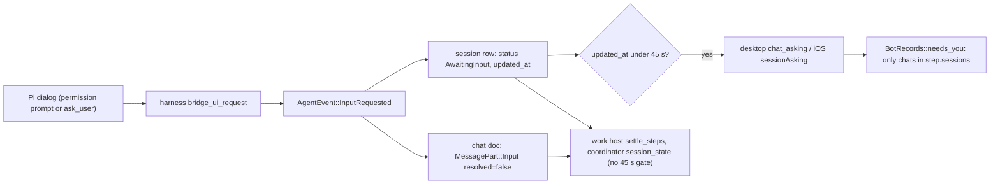

# Plan questions and Needs you

Status: investigation (step 1 of 2) and fix (step 2), 2026-11-25. §5 is the plan; §6 the
wire shape; §7 what step 2 changed where it differs from §5.

Owner's report: a workspace plan starts sessions in a project; when such a session asks
something, the question sometimes never reaches the workspace's **Needs you**, so the
plan stalls silently. Two plan step sessions, 90f7dfc6 (1 h 45 min) and 56d8cced (about
45 min), sat on permission prompts the owner never saw.

This note lists every way a plan's session can ask, follows each one through every place
that should show it, and names the root cause of each miss. Code references are against
`origin/main` `789ddd8c`.

## 1. How a question is stored and read today

- **Every question is one mechanism.** A permission prompt and an `ask_user` question are
  both Pi extension dialogs (`select`/`confirm`/`input`/`editor`). `bridge_ui_request`
  (`crates/harness/src/pi/session/ui.rs`) turns each into a `UserInputQuestion`
  (`permission: Some(..)` for a permission prompt), and the engine's input bridge
  (`SessionsEngine::dispatch`, `crates/engine/src/session/engine.rs`, the `request_input`
  closure) emits `AgentEvent::InputRequested`. The run loop sets the row to
  `AwaitingInput` (`RunLoop::record`, `crates/engine/src/session/engine/run_task.rs`) and
  the fold appends an unresolved `MessagePart::Input` to the chat doc
  (`crates/doc/src/parts.rs`).
- **Subagents are child chats.** pi-agent-squad's `subagent` tool, sync or async, runs
  as a Cypher child chat (`pi-runtime/patches/pi-agent-squad-cypher-host/cypher-host.ts`,
  `StartSubagent`). A child is on the parent's device and hidden. Its question is asked
  in the child, and `Inner::forward_input` (`crates/engine/src/session/engine.rs`) copies
  it into the root chat as a separate assistant entry (`asked_by: Some(agent)`) and
  *holds* the root's row at `AwaitingInput` (`hold_awaiting_input` / `held_statuses`)
  until the question settles.
- **What "asking" means to each reader:**

  | Reader | Rule | 45 s gate |
  |---|---|---|
  | Desktop Needs you, workspace logo count, picker (`bot_needs`, `chat_asking` in `crates/ui/src/shell/bots.rs`) | `display_status_for(chat) == AwaitingInput`, for chats in `work.session_ids()` (plus routine runs) via `BotRecords::needs_you` (`crates/proto/src/bot_records.rs`) | yes, `effective_indicator` (`crates/proto/src/view.rs`, `SESSION_STALE_MS`) |
  | Desktop Dock badge (`AppState::attention_count`, `crates/ui/src/state/queries.rs`) | a workspace session counts while `AwaitingInput` and unseen | yes |
  | iOS Needs you (`WorkspaceData.sessionAsking`, `apps/ios/Cypher/Bots/WorkspaceData+Bots.swift`; `BotRecordSet.needsYou`) | twin of the desktop rule | yes, `effectiveStatus` / `sessionStaleMs` (`apps/ios/Cypher/Models/Entities.swift`) |
  | Work host step state (`settle_steps` + `reconcile` in `crates/engine/src/bots/work/host.rs`) | step `Asking` while any of its sessions' rows says `AwaitingInput` | **no** |
  | Coordinator `wait_for_session` (`session_state`, `pending_input` in `crates/engine/src/bots/work/coordinate.rs`) | row `AwaitingInput` and an unresolved input part in the doc → `Asking`; `Idle` → `Finished` | **no** |
  | Worker push (`apps/edge/src/notifications/notifications.ts`, `chatAttention` in `notifications-model.ts`) | a host-reported transition *into* `awaitingInput` for a chat with `startedBy` ("input" attention); a child chat takes its parent's attention | no (transition-based) |

- **Freshness is a heartbeat of the run.** Only a live run refreshes its row:
  `RunLoop::next` ticks every 15 s and calls `touch_session`, throttled to 20 s, so a
  row is rewritten about every 30 s while its run (turn or parked persistent session)
  is alive. Nothing refreshes a row whose run has ended, a held root without a run, or
  the rows of a device that is offline.

So the desktop and iOS see a question only while three things hold: the asking chat is
a step session itself (not a child), its row says `AwaitingInput`, and something
rewrote that row in the last 45 s. The work host and the coordinator need only the
first two. The misses below are the cases where one of the three fails while the
question is still open; in all of them the work row says *a session is asking* and the
coordinator tells the plan "they see the request in the session and under Needs you"
(`render_wait`), which is not true, so the plan waits on an owner who sees nothing.

## 2. Results

Legend: ✓ shown / correct, ✗ missed, ~ shown but wrong or flickering. "Logo" is the
workspace's Needs you count (the same `bot_needs` list) and, separately, the Dock badge.

| Case | Desktop Needs you | Logo / Dock badge | Work row + step | `wait_for_session` | iOS Needs you | Worker push | Root cause of the miss |
|---|---|---|---|---|---|---|---|
| (a) permission prompt in the step session, run live, same device as the viewer | ✓ | ✓ / ✓ (until seen) | Running, step Asking | `Asking`, permission wording; `answer_session` refuses (owner only) | ✓ | ✓ one "input" push | none while the run heartbeats |
| (b) `ask_user` in the step session, run live | ✓ | ✓ / ✓ | Running, step Asking | `Asking` with the questions; the thread may answer | ✓ | ✓ | none (same path as (a)) |
| (a/b) the same, viewer on another device than the session's host, host online | ~ shown; drops out whenever a touch is late | ~ | Running, step Asking | `Asking` | ~ | ✓ | the only proof of an open question is a heartbeat every ~30 s against a 45 s window; one late or lost registry write (loaded host, socket reconnect) hides it until the next |
| (c) sync subagent asks (child chat), parent turn running | ✓ via the mirror in the step session (root held `AwaitingInput`, root run heartbeats) | ✓ / ✓ | Running, step Asking | `Asking` on the mirror; permission wording | ✓ | ✓ for the root; the child chat is reported too (attention "input" from its parent), a possible second push, not verified | none while the root's run is alive; the child chat itself is never a plan chat (`needs_you` reads `step.sessions` only) |
| (d) async subagent asks, the step session's turn already ended, its persistent session still parked | ✓ (parked run still heartbeats) | ✓ / ✓ | Running, step Asking | `Asking` | ✓ | ✓ for the root | none yet |
| **(d′) async subagent question open when the parked step session is reaped (30 min, `SESSION_IDLE`), or asked after its run ended** | ✗ 45 s after the run ends | ✗ / ✗ | Running, step **Asking** (raw row) | **`Asking`**, "your owner sees it under Needs you" | ✗ | ✓ once, when it was asked | the held root row has no run behind it, so nothing refreshes `updated_at`; every client reads it as stale. The child's own row stays fresh, but the child is not a plan chat. Proven by `a_question_forwarded_into_an_ended_parent_goes_stale_today` |
| (e1) step session's own question open across an engine restart (mid-turn) | ✗ | ✗ / ✗ | Running, step Running (row `Idle` after `recover_stale`) or Working if auto-resumed | **`Finished`** (row `Idle`; the open part is ignored) or `Working` while resumed | ✗ | push withdrawn (the Worker settles the input notice on the `idle` report) | by design the question stays answerable (`pending_input_request` in `crates/ui/src/composer/layout.rs` keeps showing it; `RespondInput`'s dead-run fallback in `crates/engine/src/host/doc_host/commands.rs` answers it as a new turn), but "asking" is read only from the row, which recovery set to `Idle`. The coordinator then reports the step session as finished. Proven by `a_question_open_across_a_crash_is_not_asking_after_recovery_today` |
| (e2) forwarded (subagent) question open in a parked or ended step session across an engine restart | ✗ | ✗ / ✗ | step **Asking forever** | **`Asking` forever** on a dead mirror | ✗ | no change (the Worker keeps the old input notice until it expires) | the forward map and `held_statuses` are memory only; the root's journal is not stale, so `recover_stale` never rewrites its durable row, which stays `AwaitingInput` with an old `updated_at`. Clients hide it as stale (right: the child's question died with its run), but the work host and the coordinator read the raw row and the unresolved mirror and wait for an owner who sees nothing. Answering the mirror is rejected ("the subagent's question is no longer pending") |
| (f) step session on another device that goes offline (sleep, network) with its question open | ✗ 45 s after its last touch | ✗ / ✗ | Running, step Asking | `Asking` | ✗ | ✓ when asked (the host reported it before going offline) | freshness is the heartbeat of a run on a device that no longer reaches the registry; the question is still open (answerable as soon as the device is back) but every client drops it instead of showing it as waiting for its device |
| (g) a session the plan steers but did not start (`steer_session` after the owner allowed it) | ✗ | ✗ / ✓ (as a normal session) | step unchanged | `Asking` | ✗ | as an ordinary session | `needs_you` and `settle_steps` read only `work.session_ids()`; `steer_session` (`may_drive`) does not record the session on the work |
| (h) the step session's second question while its row already reads `AwaitingInput` (e.g. a subagent asks while the session's own prompt is open) | ✓ (row stays fresh) | ✓ | step Asking | `Asking` on the newest | ✓ | ✗ no new push: the host reports only status changes (`Signature` in `crates/engine/src/host/notification_events.rs`), and the status didn't change | push is keyed on status transitions, not on questions |

Not misses but worth knowing:

- A plan's work thread is unattended (`profile::is_unattended`): its own dialogs stop the
  run with a reason instead of asking, so it never needs Needs you.
- `needs_you` keeps listing a session after its work ended ("whatever its work did since"),
  but only while the work row exists: past `KEEP_FINISHED_WORK` (40) the row is pruned
  and an old session still asking drops out.
- The desktop re-evaluates the 45 s gate only when something re-renders (the sidebar
  has a 1 s `MARK_REFRESH`; I found no timer under `crates/ui/src/shell/bots/`), so a
  stale item can also linger after its question ended, and an item hidden as stale
  comes back only with the next row write.

### The two reported stalls

The production log (`~/.cypher/logs/cypher-headed.log.old`, INFO level) shows both
chats joining their rooms (90f7dfc6 at 2026-11-22 06:28, 56d8cced at 2026-11-24 15:41)
and being reaped as idle persistent sessions later (09:34 and 03:00 next day). It
records no "subagent question forwarded" line at all, and input requests and status
changes are not logged at INFO, so the log can't tell which row above they were. Both
were permission prompts in a step session on this Mac mini, watched from another
device: rows (a/b) on another device, (f) or (e1) fit; (d′) does not (no forward).
Reading the installed app's synced data to settle it was out of scope for this step.

## 3. Evidence

Seen live: none. The private dev instance could not be started: this step ran
unattended in the agent sandbox, where `~/.cypher-development/` is not writable
(`mkdir ~/.cypher-development/plan-asks-surface` → "Operation not permitted"), and the
dev scripts need an out-of-sandbox approval, which the brief ruled out. So there are no
screenshots; every row is from code or tests.

Tests added (both assert today's behaviour; step 2 flips the marked assertions):

- `crates/engine/tests/it/subagents/child_bridge.rs`:
  `a_question_forwarded_into_an_ended_parent_goes_stale_today` (`#[ignore]`, ~50 s;
  run with `cargo test -p cypher-engine --test it -- --ignored --exact
  subagents::child_bridge::a_question_forwarded_into_an_ended_parent_goes_stale_today`).
  The parent's run ends, a subagent then asks: the question is open in the parent, the
  parent's row stays `AwaitingInput` with the same `updated_at` for 50 s and reads as
  `Indicator::None`, while the child's row stays fresh. Rows (d′) and, by the same
  mechanism, (f). Passed 2026-11-25.
- `crates/engine/tests/it/turns/restart_resume.rs`:
  `a_question_open_across_a_crash_is_not_asking_after_recovery_today` (runs in CI,
  fast). A run dies under an open permission prompt (manufactured kill -9 state, no
  auto-resume): after boot recovery the question is still unresolved in the doc, but
  the row is `Idle` and reads as not asking. Row (e1). Passed 2026-11-25.
- `crates/proto/src/bot_records.rs`:
  `plan_questions_outside_fresh_step_rows_are_missed_today` (runs in CI). A child
  chat's open question is not in `needs_you`; a step session whose `AwaitingInput` row
  is 46 s old is not either, while the step still reads `Asking`. Rows (c)/(d′) child
  part, (f), and the work row vs Needs you split. Passed 2026-11-25.

From code only: (a), (b), (c), (d) (the existing `child_bridge` tests
`child_question_is_forwarded_to_the_parent_and_answered_there`,
`a_parent_between_turns_still_gets_the_question` and
`the_parent_turn_ending_keeps_the_question_open` cover the engine part), the
coordinator half of (e1) (`session_state` maps `Idle` to `Finished`), (e2), (g), (h),
every iOS cell (a line-by-line twin of the desktop rule) and every push cell.

## 4. Root causes, in one line each

1. **"Asking" is read from a liveness heartbeat, not from the question.** The open
   question lives in the chat doc; clients infer it from a row status that only a live
   run keeps fresh (d′, e1, f, the flicker in a/b).
2. **"A plan's chat" is only `step.sessions`.** Child chats under a step session and
   sessions the plan steers are not plan chats (c, d′, g); a child's question reaches
   Needs you only through its mirror in the root, and only while the root's row is
   fresh.
3. **Recovery doesn't reconcile questions.** After a restart nothing recomputes this
   device's rows from the docs: an answerable own question reads `Idle` (e1), a dead
   forwarded one stays `AwaitingInput` (e2).
4. **Engine and clients disagree.** The work host and the coordinator read the raw row
   without the 45 s gate, the clients with it, so the step says *asking* and the plan
   is told the owner sees it while Needs you is empty.
5. **Push is per status transition, not per question** (h).

## 5. The fix for step 2: one rule

> A plan's question is any question open in a chat the plan started or steered, or in
> any child chat under one: an unresolved input part (permission prompt or question)
> that is still answerable. It stays a question until it is answered or withdrawn, or
> its chat ends. It does not depend on a fresh heartbeat: when the chat's host device
> is offline it is shown with "waiting for its device".

Put the open question on the durable session row so every reader uses the same fact:

### Proto (`crates/proto`)

- `entities.rs`: add `Session.asking: Option<SessionAsk>` (`request_id`, `asked_at`,
  `permission: Option<PermissionPromptKind>`, `asked_by: Option<String>`), serde
  default, so old rows read `None`.
- `view.rs`: a pure `asking(session, now) -> Ask` (`None`, `Asking`, `AskingOffline`)
  that is true while `session.asking.is_some()` whatever `updated_at` says; make
  `effective_indicator` / `display_status` show `AwaitingInput` for it instead of
  aging it out. Keep the 45 s gate for `Working` only.
- `bot_records.rs`: `BotWork::session_ids()` also yields sessions the work steered
  (new `WorkStep.steered` or a work-level list, written by `steer_session`), and
  `needs_you` takes an `asking(chat)` that callers implement as "this chat or any
  descendant child chat asks" (a shared pure helper,
  e.g. `plan_question(chats, sessions, chat_id)`, walking `Chat.child.parent_chat_id`
  with the same depth bound as `MAX_FORWARD_DEPTH`). Flip
  `plan_questions_outside_fresh_step_rows_are_missed_today`. Shared JSON vectors for
  the iOS twin, like `slash-commands-v1.json`.

### Engine (`crates/engine`)

- `session/engine.rs`: maintain `Session.asking` in `write_status`/`set_status` from the
  run's pending inputs: set on `InputRequested`, cleared on `InputResolved`, set on the
  root by `forward_input`/`hold_awaiting_input` and cleared by `retire_forward`/
  `release_awaiting_input`. The row write is then a real change, not a touch.
- `session/engine/recovery.rs`: after `recover_stale`, a boot sweep of this device's rows
  that recomputes `asking` from each doc: an own question left by a dead run stays open
  (it is answerable through the dead-run fallback), and a forwarded mirror whose source
  is gone is resolved and its hold released (fixes e1 and e2). `recover_stale` must not
  clear `asking` when it sets `Idle`.
- `bots/work/coordinate.rs`: `session_state` returns `Asking` from `row.asking` (and the
  doc) whatever `row.status` is, so `Idle` with an open question is `Asking`, not
  `Finished`; `render_wait` says "waiting for its device" when the host is offline.
  `steer_session` records the steered session on the work.
- `bots/work/host.rs`: `reconcile`'s `asking` closure and `settle_steps` use the same
  rule (row `asking` on the session or a descendant).
- `host/notification_events.rs`: add `asking.request_id` to `Signature` so each new
  question is reported (fixes h); report the root, not the child, for a forwarded
  question.
- Flip `a_question_forwarded_into_an_ended_parent_goes_stale_today` and drop its
  `#[ignore]` if it can run without the 50 s sleep (assert `asking` instead of age),
  and flip `a_question_open_across_a_crash_is_not_asking_after_recovery_today`.

### Desktop (`crates/ui`)

- `shell/bots.rs`: `chat_asking` uses the shared rule (the chat or a descendant has
  `asking`), independent of `display_status_for`'s staleness; `bot_needs` and the logo
  count follow. The Needs you card for a chat whose host is offline says "Waiting for
  its device" (device presence: `AppState::device_online`).
- `state/queries.rs`: `attention_count` counts a workspace session whose `asking` is set.
- Re-render Needs you when an offline label would change (a timer like `MARK_REFRESH`),
  or derive it only from presence changes.

### iOS (`apps/ios`)

- `Models/Entities.swift`: `SessionRow.asking`; `effectiveStatus` keeps
  `awaitingInput` while `asking` is set.
- `Bots/WorkspaceData+Bots.swift`: `sessionAsking` uses the shared rule (descendants
  included); `Bots/BotRecordSet.swift` `needsYou` takes steered sessions too. Offline
  label on the Needs you card. Unit test against the shared vectors.

### Worker (`apps/edge`)

- `src/notifications/notifications.ts`: `mayBeAsking` and the `awaitingInput` path read
  the row's `asking` (a new question is a new notice even without a status change;
  `claim` keyed on the request id); a child chat's input whose question is mirrored
  into its root does not push a second time.
- `src/notifications/notifications-model.ts`: `chatAttention` unchanged; a helper that
  says whether a row's question is a plan's (startedBy, or a child under one).

Old hosts write no `asking`: clients fall back to today's rule for rows without the
field, so mixed versions behave as now.

## 6. Wire shape (step 2)

The rule is in `crates/proto/src/view/plan_asks.rs`; every client and the Worker run
`protocol/vectors/plan-asks-v1.json` (20 cases, one per row of §2 plus fallbacks and
edges; Rust runner `crates/proto/tests/plan_asks_vectors.rs`).

- **Session row** (registry `sessions`, times in epoch ms) gains `asking`, present only
  while a question is open:
  `{"requestId": "r1", "askedAt": 1795599980000, "permission": "escalate",
  "askedBy": "reviewer", "fromChatId": "k1"}`. `requestId` is the doc's unresolved
  `MessagePart::Input` id (a mirror's own id for a forwarded question), the newest one
  when several are open; a new id is a new question (the Worker keys its notice on it).
  `permission` (a `PermissionPromptKind`) only for a permission prompt; `askedBy` (the
  subagent's name) and `fromChatId` (the child chat that asked) only on a root that
  mirrors a child's question — the child's own row carries `asking` too, so a reader that
  reports once per root skips rows whose question is mirrored (the root's `fromChatId`
  names the child). `askedAt` is epoch ms here (not RFC 3339 like the typed
  `updatedAt`), so the registry and the typed shape agree. Rows without it come from old
  hosts.
- **Work row** (`bot_work`) gains `steered: [chat id]`, the sessions `steer_session`
  drove. Deviation from §5: it is a work-level list, not part of `session_ids()`, because
  `session_ids()` is also the "started by this work" test that lets the plan answer,
  steer and stop a session without the owner (`may_drive`) and the set a stopped plan
  stops; a steered session must keep needing the owner's approval. `plan_chat_ids()` =
  started then steered, each once; a steered session's question marks the *current*
  step (the first Running/Asking one) Asking (`settled_steps`).
- **The rule** (pure): `session_ask(row, now, hostOnline)` = `asking` present → Asking
  (AskingOffline when the row's `deviceId` isn't online), else the old rule
  (`awaitingInput` and `updatedAt` under 45 s). `effective_indicator` reads
  `AwaitingInput` whenever `asking` is present, whatever the status or age.
  `ChatTree::question(chat)` walks the chat, then its child chats (`child.parentChatId`)
  level by level, 8 deep, children in id order; the first chat that asks is the answer
  (`askingChatId`). An archived chat has ended: it asks nothing and hides its subtree.
  Needs you lists each `plan_chat_ids()` chat whose `question` is some, also after the
  work ended (as before).

## 7. Step 2: engine and desktop, and where they differ from §5

- **Engine rows.** `Inner::open_asks` (chat → open questions, oldest first) feeds every
  row write (`write_status`, `sync_asking`): `RunLoop::record` opens one on
  `InputRequested` and closes it on `InputResolved`; `forward_input` opens the mirror on
  the root (`fromChatId`, `askedBy`), `retire_forward` closes it; a second question while
  the root is already held rewrites the row (`hold_awaiting_input` → `sync_asking`), so a
  new `requestId` is a real write (h). `on_done` closes the run's own questions (their
  parts are resolved there). The dead-run answer fallback and the orphaned-mirror path in
  `execute_respond_input` close theirs (`SessionsEngine::input_closed`).
- **Boot.** `recover_stale` reopens a crashed run's own questions before it writes the
  row `Idle`, so the row keeps `asking` (e1); then `recover_open_questions` rebuilds every
  other row of this device that still says it asks: dead mirrors are resolved in the doc
  and the hold ends (e2). Differs from §5 in two places: a question is *resolved* instead
  of kept when the crashed turn is auto-resumed (the resumed turn asks again), and in a
  **child chat** (its subagent run was the parent's tool call, which died too; answering
  it would start an orphan child turn).
- **Coordinator.** `session_state`: a row with `asking` and an unresolved part in the doc
  is `Asking` whatever its status (Idle after a crash is no longer `Finished`).
  `wait_for_session` appends "its device is offline…" when the row's host has no fresh
  presence (`WorkspaceHost::device_online`, 45 s like the room's presence). It still
  reads only the session's own doc: a child's question reaches it through the mirror,
  which every live forward writes.
- **Work host.** `settle_steps` is `BotWork::settled_steps` on `plan_question` (the chat or a
  child under it, row age ignored, offline counts as asking). Steered sessions mark the
  current step (§6).
- **Notifications.** `Signature` includes `asking.requestId`, and the event body carries
  `asking`. The host still reports the child's row and the root's mirror separately;
  reporting a forwarded question once is the Worker's (skip a child whose question a
  root's `asking.fromChatId` names).
- **Desktop.** `AppState::plan_question[_in]` (shared rule, presence from
  `device_online`, an answer being sent reads as answered) drives `chat_asking` →
  `bot_needs` → Needs you, the logo count and the picker; `attention_count` counts a
  workspace session while it (or a child) asks; routines' `job_asking` too. The Needs you
  card reads and answers the question in the chat that asks (a child chat when there is
  no mirror), and says "Waiting for its device" in place of the time when the host is
  offline. The work row's ring and "Waiting on you" turn amber when any step asks, not
  only the first running one.

### Step 2 evidence

| Case | After step 2 | Verified by |
|---|---|---|
| (a) permission prompt, step session | Needs you, logo, Dock badge; step Asking, work "Waiting on you" | live (`needs-a-b.png`, `plan-step-asking.png`), vectors |
| (b) `ask_user`, step session | same | live (`needs-a-b.png`), vectors |
| (a/b) late heartbeat, other device | shown whatever the row's age | vectors, `plan_questions_outside_fresh_step_rows_are_needs_you` |
| (c) sync subagent | shown under the step session (mirror; a child without a mirror is read directly) | vectors, `plan_questions_reach_needs_you_on_the_shared_rule`, `child_question_is_forwarded_to_the_parent_and_answered_there` |
| (d′) subagent asks after the parent's run ended | the parent's row keeps `asking`; answered from the parent, the subagent gets it | `a_question_forwarded_into_an_ended_parent_stays_asking` (no longer ignored, < 1 s) |
| (e1) own question across a crash | row Idle with `asking`; coordinator `Asking`; the answer runs as the next turn | `a_question_open_across_a_crash_is_still_asking_after_recovery`, `an_idle_row_with_an_open_question_is_asking`; live only the auto-resume variant (`e1-after-crash.png`: the resumed turn asks again and is answered from Needs you, `e1-answered.png`) |
| (e2) dead forwarded question across a restart | mirror resolved, hold released, own question kept | `boot_recovery_resolves_dead_mirrors_and_keeps_own_questions`, vectors |
| (f) host offline | shown, "Waiting for its device"; coordinator says the device is offline | vectors, `plan_questions_reach_needs_you_on_the_shared_rule`; not live (a local dev instance has no peers) |
| (g) steered session | Needs you, current step Asking; steering again still needs the owner | vectors, `steered_sessions_are_plan_chats_but_not_started_ones`, `steered_sessions_are_recorded_once_and_bounded`; not live |
| (h) second question | row's `asking` moves to the newest and back; reported as a new event | `a_second_question_moves_the_row_to_the_newest`, `a_new_question_is_reported_without_a_status_change` |

Live: private dev instance `plan-asks-surface` (local mode, mock harness), shots in
`~/.cypher-development/plan-asks-surface/shots/after/`. Answering from Needs you moved the
step back to Running and finished the session (`plan-continues.png`). A graceful engine
stop ends runs and their questions (and fails a running plan, as before); only a crash
leaves a question open.

### Step 2, iPhone and Worker (part B)

- **iPhone** (`apps/ios`, commit `1d1530ee`). `SessionRow.asking` (lenient: a malformed
  value reads as no question); `effectiveStatus` keeps `awaitingInput` while it is set.
  `Bots/PlanAsks.swift` ports `plan_asks.rs` (`sessionAsk`, `ChatTree.question`,
  `findPlanQuestion`); `BotWork.steered`, `planChatIds`, `settledSteps`. Needs you, the
  workspace counts and the Asking page read the rule; the card answers in the chat that
  asks and says "Waiting for its device" when its host is offline; a push naming a plan's
  session opens its Asking page. `PlanAsksTests` runs every vector. Demo:
  `-demo-plan-asks` (cases a, b, d′ child, e1, f under one plan), `-plan-asks-answer <chat>`.
- **Worker** (`apps/edge/src/notifications`, commit `f4852113`). An open question awaits
  input whatever the row's status says; each new `asking.requestId` is its own claim, so
  it is a new `input` notice without a status change (h), the same id never twice. A
  plan's session, or a subagent's chat under one, asks as its workspace's Needs you item
  (`itemKind: "asking"`, `itemId` = the plan's session) instead of as a session notice:
  it is muted with the workspace, not the project, and a tap opens the workspace. With
  the workspace gone it notifies as itself, as before. A question mirrored into a chat
  above (whose `asking.fromChatId` names the child) pushes once, for that chat; a
  child's alert already queued is withdrawn. Old hosts send no `asking` and notify as
  before.
