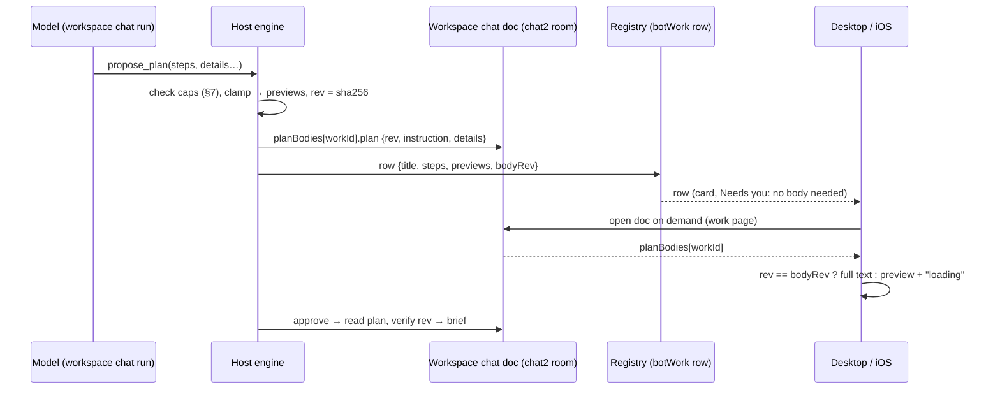

# Plan bodies: long plan text out of the registry row

Status: built (2026-11-22; the owner took every recommendation in §13). As built: [agent-bots.md §6.7](agent-bots.md#67-as-built-p2).

A workspace plan is one `botWork` registry row. Every text in it is capped so the row fits
the registry, which makes long plans impossible. This design keeps the row as the plan's
index and moves the long text into the **workspace chat's own doc**, where the host
already writes and every owner device can read.

## 1. The problem, with the current limits

The registry is the index of all work and every owner device holds every row
(`docs/design/registry-sync.md`). The Edge refuses an op whose `JSON.stringify(op).length`
(UTF-16 units, not bytes) passes `MAX_OP_BYTES = 16 * 1024`
(`apps/edge/src/registry/registry-core.ts:62`, "a row is an index entry, never a
document"). The engine refuses a record above `RECORD_MAX_BYTES = 14 * 1024` units
(`crates/doc/src/registry.rs:1718`). `BotWork::clamp` then keeps a work row under
`WORK_ROW_MAX = 13_800` (`crates/proto/src/bot_records.rs:64`, `fit_row` at :493).

| Text | Cap (main, `6b03e3cc`) | Who writes it, and what happens over the cap |
| --- | --- | --- |
| step detail | `STEP_DETAIL_MAX = 1_500` (`bot_records.rs:56`) | model; `propose_plan` refuses (`coordinate.rs:691`). Being removed on another branch |
| all step details | `PLAN_DETAILS_MAX = 4_000` (`bot_records.rs:59`) | model; refused (`coordinate.rs:702`) |
| instruction | `INSTRUCTION_MAX = 1_500` (`bot_records.rs:65`) | the owner's newest message, copied; **cut**, and the model and the brief are told (`coordinate.rs:834`, `text.rs:175`) |
| result | `RESULT_MAX = 2_000` (`bot_records.rs:66`) | model via `finish_work`: refused (`coordinate.rs:1738`). Host via `settle_work`/`stop_work` (`host.rs:652`, `:716`, quoting the thread's last message): silently cut by `clamp` |
| title / summary / step title / step note | 120 / 400 / 160 / 200 | stay as they are |

The tool tells the model these limits (`crates/harness/src/pi/bot-tools.ts:169`, `:300`).
That file is embedded in the engine binary (`crates/harness/src/pi/spawn.rs:245`,
`include_str!`), so it ships with the engine, not with the Pi Runtime.

## 2. Corrections to the proposed direction

The proposal was: keep the index in the row and move the long text into the workspace
chat doc (the chat2 room, "1 MiB per row"), which "every device showing the plan card
already syncs", and have the host read it locally. That direction holds. Here is what the
code says against its details:

1. **The plan card does not need the body.** The card shows the title, the step count and
   where, the summary and the buttons (`crates/ui/src/transcript/bot_plan.rs:1-9`, `:574`).
   Needs you shows the summary (`crates/ui/src/shell/bots/needs.rs:172`); iOS is the same.
   Only the **work page** (the detail panel) reads the instruction, the details and the
   result (`crates/ui/src/shell/bots/work.rs:512`, `:524`, `:945`;
   `apps/ios/Cypher/Bots/Board/WorkPages.swift:98`, `:123`, `:326`). That page can be
   opened from the board's Work list, from Needs you or from a sidebar row, on a device
   that has not loaded the workspace chat. iOS keeps only 8 chat docs live
   (`AppModel.liveSessionLimit`, `apps/ios/Cypher/App/AppModel.swift:39`). So clients must
   **open the chat doc on demand**. They cannot assume they already have it.
2. **"1 MiB per row" is a limit on one pushed update, not on a doc.** `MAX_ROW_BYTES =
   1024 * 1024` (`apps/edge/src/chat/chat-log.ts:17`) bounds a single Loro update a client
   pushes. Nothing bounds a doc's total size. The chat2 design keeps docs thin on purpose
   (`docs/design/chat2-sync.md` A), and Loro keeps everything ever written in the doc's
   history. Even so, bodies need their own cap (§7), and deleting a body does not shrink
   the doc (§8).
3. **Two of the three texts are already in that doc.** The instruction is the owner's
   newest message in the same chat (`latest_owner_message`, `coordinate.rs:858`). The
   result is already written there in full as the result notice's post
   (`post_work_notice`, `host.rs:298`; `notice.rs:150`). Only the step details are new to
   the doc. The `propose_plan` call's arguments are not in the doc: `sanitize_tool_call`
   drops the input of unknown tools (`crates/doc/src/parts.rs:603`).
4. **"Engine before apps" is the wrong rollout order.** The engine is the writer, and on
   desktop it ships in the same bundle as the UI. The safe order is readers no later than
   writers: the iOS reader ships with or before the desktop release that raises the
   limits (§10). No Runtime min-version bump is needed, because `bot-tools.ts` is not in
   the Runtime.
5. **Not every device has a reason to show the work.** Peers (connected workspaces) never
   see `botWork` rows. The Edge's notification model reads no plan text (`apps/edge/src/
   notifications/` has no `botWork` reference). So the only case is an owner device that
   has the row but has not synced the doc yet (offline, a cold phone, a doc still
   catching up). It shows the preview (§5).
6. **The registry cap is counted in UTF-16 units per op**, not 16 KiB of bytes per row.
   The engine stops earlier, at 14 Ki units for the record and 13,800 for a work row.

## 3. Data shape

### What stays in the row

Everything the row holds today stays, with the same meaning, so old apps keep working:
id, title, summary, state, steps (id, title, project, state, sessions, note, times, session
choice), session ids, `decision`, `stopRequestedAt`, times and limits.
`instruction`, `steps[].detail` and `result` become **previews**. They are made by today's
`clamp` (per-step and across-plan shares, the longest detail giving way first, an
ellipsis marking each cut). Two new host-written fields:

```rust
// BotWork (crates/proto/src/bot_records.rs)
/// Set when the plan's text was cut to fit the row: the rev of the full text in the
/// chat doc's `planBodies[id].plan`. Absent = the row is the whole plan.
#[serde(default, skip_serializing_if = "Option::is_none")]
pub body_rev: Option<String>,
/// The same for `result` (`planBodies[id].result`).
#[serde(default, skip_serializing_if = "Option::is_none")]
pub result_rev: Option<String>,
```

**A body exists only when something was cut** (decision D1). A plan that fits today's caps
is written exactly as today: no doc write, nothing to load, old apps see all of it. One
rule tells readers what to do: `bodyRev` present means the row's plan text is a preview.
Rows from older hosts have no `bodyRev`, so they fall under the same rule.

### What moves, and where in the doc

A new root map in the chat doc of `work.chatId` (the workspace chat), beside
`sealedAttachments` and `failedUploads` (`crates/doc/src/schema.rs`):

```text
planBodies: LoroMap {
  <workId>: LoroMap {
    plan:   { rev, instruction, details: { "<stepId>": "<full detail>" }, at }   // written once, at propose
    result: { rev, text, at }                                                    // written once, when it ends
  }
}
```

- The values are plain JSON values (not `LoroText`): each is written whole, once, so one
  write is atomic and last-writer-wins.
- `rev` is the first 16 hex characters of SHA-256 over the value's canonical JSON with
  `rev` left out. Only the host computes it (`sha2` is already an engine dependency).
  Clients never hash. They compare the row's `bodyRev` with the stored `rev` as strings.
  A match means "this is the body the row was written with". A mismatch, or no entry, means
  "not here yet" (or tampered with; see R5).
- `instruction` holds a **copy** of the owner's message, not a reference to it (D3). The
  orchestration's brief must not change under it, and a copy is simpler than resolving a
  message id that a fork or a lineage adoption (chat2-sync M3) could make stale.

## 4. Who writes what, and when

Only the bot's host writes bodies. It hosts the workspace chat: `CreateBot` runs on the
host and writes the bot chat there (agent-bots §9). It already writes host-only root maps
and posts into that doc (`sealedAttachments`, `seal_attachment` at
`crates/engine/src/host/doc_host.rs:818`; `post_notice`). Owner devices still write only
`decision`, `stopRequestedAt` and `timeAddedMinutes`. A body is never edited after it is
written. Plan editing is not built. If it ever is, it writes a new `plan` with a new rev.

| Moment | Code | Doc write (first) | Row write (second) |
| --- | --- | --- | --- |
| propose | `propose_plan`, `coordinate.rs:642` | if anything was cut: `planBodies[id].plan`, then `flush_chat_sync` | the row with previews and `bodyRev` (`put_record`, `:805`) |
| approve / cancel | owner `Mutate resolveBotPlan` (`rpc/bots.rs:105`) | none | `decision`, as today |
| start | `start_work` / `dispatch_brief`, `host.rs:402`, `:494` | reads `plan`, checks `rev == bodyRev`; the brief (the thread's first Run prompt, in the thread's own doc) carries the full text | `running`, as today |
| step updates | `update_step`, `edit_work` (`work.rs:524`) | none | as today. The body is untouched |
| finish | `finish_work` (`coordinate.rs:1717`), `settle_work` (`host.rs:634`), `stop_work` (`:681`) | if the result was cut: `planBodies[id].result` | state, result preview, `resultRev` (`edit_work`) |
| notice | `post_work_notice` (`host.rs:298`) | the post's text is the **full** result (from the body when `resultRev` is set) | none |

**Order: the doc first, then the row.** That way a client never sees a row pointing at a
body the host failed to write.

- The doc write fails (doc won't open, disk). `propose_plan` and `finish_work` return an
  error to the model ("the plan couldn't be saved; propose it again"), and no row is
  written. `settle_work`/`stop_work` run without a model. They write the row with the
  preview and no `resultRev`, log a warning, and the result is cut to the preview. This is
  the one cut left, and it happens only when the host's own doc fails.
- The doc write lands but the row write fails, or the engine crashes between the two. The
  body is an orphan with no row pointing at it, and the cleanup pass removes it (§8).
- Both land, but they reach other devices in either order: the registry room and the chat2
  room are separate channels, each with its own durable outbox (`chat_outbox`; the
  registry's pending ops). Readers handle every order (§5).
- `edit_work` holds the row lock (`work.rows`). Write the body before taking it and pass the
  rev into the closure, so no doc I/O happens under the lock.
- `record_fields` skips `None` fields, so `bodyRev`/`resultRev` can never be cleared by
  leaving them out. That is fine here, because they are written once. Note it for any
  later edit feature.

**At start the host refuses a missing or mismatched body.** The plan fails with "Its full
text is missing on its host" and is never run on previews. A real plan always has its body
on the host, because the host wrote it there itself.

## 5. How the apps load it



- **Desktop.** Add a stream RPC `WatchPlanBody {chatId, workId}`, forwardable like
  `WatchDocMessages` (`crates/rpc/src/lib.rs:144`). The engine opens the doc through
  `DocHost::open` (it joins the room as a client when another device hosts the chat) and
  sends `{plan?, result?}` now and on every doc change. The work page subscribes while it
  shows a work item whose row has `bodyRev` or `resultRev`. It renders the body's text when
  the rev matches, and otherwise the row's preview with a quiet "Loading the full plan…"
  line under the cut text. The card and Needs you do not change.
- **iOS.** `SessionStore` already holds the whole Loro doc (`apps/ios/Cypher/Sync/
  SessionStore.swift`). Add a `planBodies` read beside `commands`. The work page warms the
  workspace chat's store (`model.warmSessionStore(for:)`) while it shows, and reads
  the body when the rev matches. It works offline from the disk snapshot. This is better
  than memory's model, where the page asks a desktop over the relay (`watchMemory`) and
  shows nothing when no desktop is online.
- **Before the body arrives** (row first, doc behind, or offline): show the preview,
  marked as cut. Approve stays enabled (D5). The card already lets the owner approve
  without the details.
- **Body first, row behind:** nothing to show yet. The row is the index; the body is
  ignored until a row points at it.
- **Host tools.** `get_work` and the brief read the body locally (`text.rs:112` takes the
  body's text instead of the row's). `list_work` uses the row. The notice's wake prompt
  still clips the result to `WAKE_OUTPUT_MAX` (`notice.rs:28`) and should say it was cut
  and that `get_work` shows all of it.

## 6. Old apps and existing plans

- **No migration.** Existing rows have no `bodyRev`, so they are complete as they are,
  and every reader keeps its current path for them.
- **Old apps reading a new row** see the previews: the same caps as today, each cut
  marked by "…". Serde and Swift `Codable` ignore the unknown `bodyRev`/`resultRev`. Once
  a plan is running, its thread page shows the full brief, because the brief is that
  thread's first message. Risk R1: an owner on an old phone approves after reading only
  the preview.
- **Old hosts** never write bodies and keep today's caps. A workspace gets long plans
  only once **its host device** runs the new engine (as with every engine-side workspace
  change).
- **A downgraded host** would keep the rows and, through `clamp`, keep the previews. Its
  brief would use the previews. Accept this; downgrades are not supported.

## 7. Safety caps: refused, never cut

New constants in `bot_records.rs`. Each is refused with the overshoot, like the refusals
the engine sends today:

| Text | Cap | Over it |
| --- | --- | --- |
| step details, in all | `PLAN_BODY_MAX = 30_000` characters (no per-step cap) | `propose_plan` refuses: "The steps' details add up to N characters; a plan holds at most 30,000…" |
| result (`finish_work`) | `RESULT_BODY_MAX = 30_000` | `finish_work` refuses; the description still asks for a concise result |
| instruction | `INSTRUCTION_BODY_MAX = 30_000` | the owner's text cannot be refused: cut, and the model and the brief are told, as today |
| host-written result (a quote of the thread's last message) | 30,000 | cut, and the text says so ("…(cut)") |

Worst case for one body: about 90,000 characters, about 270 KB of UTF-8 for CJK text. That
is far under the 1 MiB update cap and is one Loro update. The brief grows to at most about
60,000 characters, roughly 15,000–20,000 tokens. Update the descriptions in
`bot-tools.ts` (`:161`, `:169`, `:300`) and any `maxLength` from `PLAN_LIMITS` (added on
the unmerged `cypher/refused-plan-cards` branch, with a harness test against
`cypher_proto`), and coordinate with the branch that removes `STEP_DETAIL_MAX`.

## 8. Deleting

- **Pruning** (the host keeps 40 finished items, `host.rs:246`) runs on the host: it
  deletes `planBodies[id]` in the same pass as the row.
- **`Mutate deleteBotWork`** (`rpc/bots.rs:154`) runs on whichever engine the app talks
  to, which may not be the host. It deletes the row only. The host's **cleanup pass**
  removes any `planBodies` key whose work row is gone and whose `at` is over an hour old.
  The hour covers the window between the doc write and the row write. The pass runs at
  engine start and then hourly, since it opens the chat doc.
- **What deleting means:** the body leaves the doc's current state, so no app shows it,
  but the text stays in the doc's Loro history, and in the room's checkpoint, until the
  chat itself is deleted. Messages already behave this way. Say so if the owner needs
  real erasure (D6).
- **Deleting the workspace** tombstones its chat. Every device runs `purge_chat`
  (`doc_host.rs:802`), which drops the local doc and the bodies with it. On the Edge the
  room is left like any deleted chat's room. This design adds nothing to that.
- **Forks or copies** of the workspace chat that carry `planBodies` along are harmless:
  rows point at their chat by `chatId`, so nothing reads a copy.

## 9. Routines' `PROMPT_MAX` and exchanges' `ANSWER_MAX`: leave them in the rows

- **Routine prompt and shortcut request** (`PROMPT_MAX = 4_000`; `bot_records.rs:1073`,
  `:1156`). An owner writes these from any device (the routine definition is
  owner-written), and an instruction that long is rare. Moving them would need owner
  devices to write chat docs, plus a doc for a routine that may have no thread yet.
  **Recommendation: keep them in the row, but stop the silent cut.** `save_routine`
  (`crates/engine/src/bots/memory.rs:361`) does not check the length, and `clamp` cuts it
  without a word, which breaks the "refuse, never cut" rule. Refuse over 4,000 in
  `save_routine` and in the routine and shortcut editors (S).
- **Exchange answers** (`ANSWER_MAX = 8_000`; `bot_records.rs:1505`). The row is a log. The
  full answer already goes where it is used: to the waiting `ask_bot` call (up to
  `ANSWER_IN_TOOL = 40_000`, `crates/engine/src/bots/network.rs:49`; "the row holds a
  clip", `network/host.rs:408`) and, when late, into the workspace chat as a durable Run
  (`deliver_late`). On the wire an answer may be up to 64 KiB
  (`bot_wire.rs:17`, `bot-frames.ts:59`). **Recommendation: don't move it.** Two small
  fixes: the exchange page could link to the delivered message, and the owner's review
  text is silently cut to 8,000 before it is sent (`rpc/bots.rs:351`), so refuse that in
  the review editor instead.

## 10. Rollout

1. Ship the readers first or in the same train. The iOS build that reads `planBodies` is
   harmless before any host writes bodies, so it can go to TestFlight ahead of the desktop
   release.
2. The desktop/Linux release contains the engine writer, the raised caps, the tool
   descriptions and the desktop reader together, since they are one bundle.
3. No hard gate. The host does not check its owner's other devices' versions; old apps
   show previews (§6). No Runtime `min` change: nothing in the Pi Runtime changes.
   No Edge change: `planBodies` is opaque Loro content to the ChatRoom.
4. A workspace gets long plans when its host updates. Say so in the release notes
   ("plans can be longer once the device hosting the workspace runs 0.4.x").

## 11. Risks

- **R1. Approval on an old app, after reading only the preview.** Mitigations: ship the
  iOS reader first; the cut is marked with "…". It is not prevented.
- **R2. Workspace chat growth.** Loro history keeps every body. A long plan of about
  10,000 characters adds about 10–30 KB that every new device downloads with the
  checkpoint. Tolerable next to a workspace chat's transcript; the 30,000 caps bound the
  worst case. A shallow snapshot or rotation for workspace chats would be a separate
  piece of work.
- **R3. A cold work page on iOS** downloads the workspace chat's checkpoint before it can
  show the body. Usually that store is warm already. The preview covers the wait.
- **R4. Two channels can disagree for a while** (row present, doc behind). The rev check
  makes this visible ("loading") and never wrong. A room that rejected a push heals
  through the host's compensating checkpoint (chat2-sync C3).
- **R5. Trust is unchanged, not improved.** The doc's content is unsigned, like the row,
  and "Only paired devices" does not cover either (`docs/design/device-trust.md`, "What
  it does not cover"). The rev check at start catches a body that differs from the row.
  It does not stop someone holding the account's bearer, who could rewrite both, exactly
  as they can rewrite today's row.
- **R6. Bigger briefs** cost more tokens per plan and keep more in the coordinator's
  context. The caps bound it.
- **R7. Two shapes to test** (row-only and row plus body) for as long as either exists.
  One reader helper (`PlanText::of(work, body)`) on each platform keeps it to one decision.

## 12. Phases

| # | What | Size |
| --- | --- | --- |
| 1 | Proto: `bodyRev`/`resultRev`, `PlanBody`/`PlanResult` types, `rev()`, caps, `clamp` as the preview maker, `PlanText::of`; doc: `SessionDoc::{put_plan_body, put_plan_result, plan_bodies, delete_plan_body}` + tests | S (~250 lines, ½ day) |
| 2 | Engine: `propose_plan`/`finish_work`/`settle_work`/`stop_work` write order and errors; brief, `get_work` and notice read the body; start-time rev check; prune and cleanup pass; `bot-tools.ts` descriptions; integration tests in `crates/engine/tests/it/bots/work.rs` (long plan end to end, crash between writes, deleted elsewhere) | M (~600 lines, 1–1½ days) |
| 3 | Desktop: `WatchPlanBody` RPC; work page reads body or preview with a "loading" line; UI tests | M (~300 lines, 1 day) |
| 4 | iOS: `BotWork` fields, `SessionStore` `planBodies`, work page warms the workspace chat store; model tests and a screenshot check | M (~250 lines, 1 day) |
| 5 | Routine/shortcut prompt and review-text refusals (§9) | S (~80 lines, ½ day) |
| 6 | Docs: agent-bots §6.7 as built, release notes | S |

Total: about 4–5 days. Phases 1–3 make one PR (one bundle), phase 4 is the iOS PR, and
phase 5 can go on its own.

## 13. Decisions

Decided 2026-11-22: the owner took the recommendation on all nine.

| # | Question | Recommendation |
| --- | --- | --- |
| D1 | Write a body for every plan, or only when the row had to cut something? | **Only when cut.** Short plans stay exactly as today (old apps see everything, nothing to load), and one rule covers old and new rows. |
| D2 | Where the body lives: the workspace chat doc, a doc per plan (like memory stores), or one plans doc per workspace? | **The workspace chat doc.** The host writes there already and iOS reads it locally and offline. A doc per plan would give real erasure and smaller loads, but it needs a new doc kind on desktop and either a Swift doc client or a relay RPC, which only works while a desktop is online, on iOS. |
| D3 | Instruction: copy the owner's message into the body, or point at the message? | **Copy.** The brief must not change under the plan, and a copy survives forks and lineage adoption. It costs at most 30,000 characters, once. |
| D4 | Caps: 30,000 for details in all, 30,000 for the result, and the owner's instruction cut at 30,000 with a notice? | **Yes**, with no per-step cap. Keep the tool text asking for a concise result. |
| D5 | Allow Approve while the page shows only the preview? | **Yes.** The card already approves without details. Mark the preview as cut and show "Loading the full plan…". |
| D6 | Is "deleted from the current doc, still in its history" enough for deleting a plan? | **Yes for now.** It matches messages, and deleting the workspace removes it all. Revisit with D2 if someone needs real erasure. |
| D7 | Previews: today's caps (rows as large as today), or smaller (e.g. 300 per step, rows about 6k)? | **Today's caps.** Old apps lose nothing. Shrink once old builds are gone if registry size matters. |
| D8 | Routines' `PROMPT_MAX` and exchanges' `ANSWER_MAX`: move them the same way? | **No.** Refuse instead of silently cutting (routine prompt, shortcut request, review text); the full exchange answer already reaches the model and the chat (§9). |
| D9 | Any version gate before a host writes long plans? | **None.** Ship the iOS reader first and note in the release that the workspace's host must update. |
